  <picture>
    <source media="(prefers-color-scheme: dark)" srcset="./dark.svg">
    <source media="(prefers-color-scheme: light)" srcset="./light.svg">
    
  </picture>

## About Me

I enjoy turning real-world problems into software solutions and continuously improving my projects.

- 🔭 Currently building a **School Fee Management System** with C# WinForms, SQL Server and Layered Architecture
- 🤝 Looking to collaborate on **React.js** and **C#**
- 👯 Looking for help with **Software Engineering best practices, System Design and Clean Architecture**
- 🌱 Currently learning **Advanced SQL, Git, and Data Structures & Algorithms**
- 💬 Ask me about React.js, JavaScript, C#, SQL, WinForms and Frontend Development

## Tech Stack

## Featured Projects

| Project | Details |
| --- | --- |
| [employee-management-system](https://github.com/zaidmuneer72-droid/employee-management-system) | Employee Management System built with React, with Admin and Employee dashboards and LocalStorage persistence |
| [frontend-ai-setup](https://github.com/zaidmuneer72-droid/frontend-ai-setup) | Repo structure setup with CLAUDE.md project rules and conventional commits |
| [nexus-3d-configurator](https://github.com/zaidmuneer72-droid/nexus-3d-configurator) | JavaScript project |
| [nutricraft-generative-ui](https://github.com/zaidmuneer72-droid/nutricraft-generative-ui) | JavaScript project |
| [flavorforge-recipe-planner](https://github.com/zaidmuneer72-droid/flavorforge-recipe-planner) | JavaScript project |
| [feedback-pulse](https://github.com/zaidmuneer72-droid/feedback-pulse) | JavaScript project |

## GitHub Stats

  
  

## Connect

<!-- Add your own links below once you have the URLs:

-->
